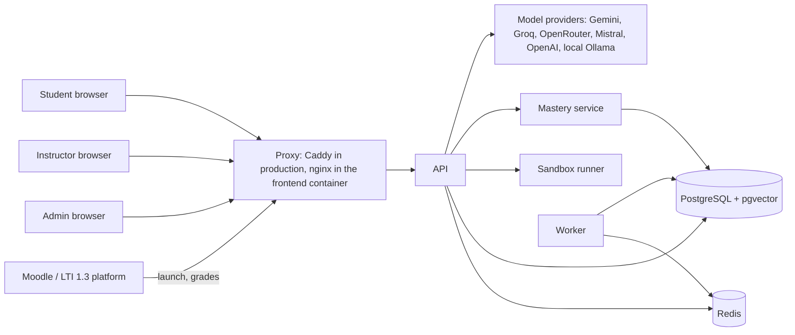

# Architecture: Adaptive AI-Powered LMS

State on 2026-10-20, branch `step-60-simulation-architecture` (code of `step-59-audit`). This document describes the system **as built**. The plan, PRD, TRD and DRD say what was intended; where they differ from the code, the code is described here and the difference is listed in section 13. Requirement IDs (F-xx, TR-xx) point into the PRD and TRD. Figures are quoted from `docs/results/` with their source; nothing here was measured for this document except where section 12 says so.

## 1. What the system is

A learning platform for programming courses. Students solve Python problems in a browser editor; every submission runs in an isolated sandbox against hidden tests; a deterministic mastery model keeps one probability per concept per student; a language model explains failures and answers questions, but only inside checks that do not depend on the model. Instructors manage courses, content, quizzes, hand-in work and grading, and read class-level insight. Admins manage accounts.

Three properties shape every design choice:

1. **The model never decides what a student knows.** Only the mastery service writes mastery, from evidence, with rules that are plain code (F-32, TR-A-02).
2. **Nothing the model writes reaches a student unchecked.** An explanation is shown only after the verifier passes it, otherwise a template hint appears; replies never contain a full solution (F-43, F-44).
3. **Student code runs only in the sandbox**, never in the API process (TR-X-01 to TR-X-08).

## 2. System context



External systems: the model providers (HTTPS, API keys from the environment), and optionally an LMS (Moodle was tested) that launches the tool and receives grades. No email service is used; notifications are in-app only (F-80).

## 3. Containers

| Container | Technology | Role | Notes |
| --- | --- | --- | --- |
| `frontend` | React, TypeScript, Vite, Monaco editor, recharts; served by nginx (unprivileged, port 8080) | Single-page app with hash routes; proxies `/api/` to the API | The Monaco editor is bundled and loaded on first use, from this origin. nginx adds `X-Request-ID` and the client address. |
| `api` | Python 3.12, FastAPI, SQLAlchemy Core, port 8000 | All HTTP endpoints (about 146), auth, rate limits, body limits, audit, the verified feedback flows, the chat router | Runs as DB role `lms_api`. Holds the local embedding model (`BAAI/bge-small-en-v1.5`, baked into the image). |
| `mastery` | FastAPI, port 8001 | The only writer of `mastery`, `mastery_events`, `misconception_state` | DB role `lms_mastery`; accepts evidence from the API with a shared token, never mastery values. |
| `worker` | Python | Embeds course notes (Redis job list, crash-safe), sweeps scheduled erasures every 60 s, applies retention | Heartbeat key in Redis is its health check. |
| `sandbox` | Python supervisor, no network (`network_mode: none`), read-only root, all capabilities dropped, 512 MB, 1 CPU, 256 processes, tmpfs work area | Runs untrusted code from job files on a shared tmpfs volume | Per-run directory, unprivileged uid, explicit resource limits, whole uid killed at the end. Custom runner instead of Judge0 (TR-X-08). |
| `db` | PostgreSQL 16 with pgvector, `max_connections=200` | System of record | Four roles (section 5). 53 application tables, 32 migrations. Each API request holds one connection for its whole run; both API pools hold 30 plus 10 overflow with a 10 s wait, and an exhausted pool answers 503 with Retry-After. |
| `redis` | Redis 7 with password and AOF | Rate-limit counters, chat history, hint counters, explanation and probe state, placement sessions, the notes job queue | No durable business data lives only here. |
| `migrate` | Alembic, one-shot | Applies migrations before the API starts | Runs as `lms_owner`. |
| `caddy` (production only, `compose.prod.yml`) | Caddy 2.10 | TLS with a self-signed certificate for the server IP, HTTP to HTTPS redirect, security headers | The only published ports (80, 443). |
| `testdb`, `mastery-test`, `worker-test`, `test` (profile `test`) | Same images | Run the test suite on a separate database (`lms_test`) and Redis database 1 | The tests never touch the app's data. |

## 4. Logical architecture of the backend

```
backend/app/
  main.py            app, middleware (request id, body limit, rate limit), error handlers; reads and checks settings at import
  config.py          settings from environment; production mode refuses weak secrets
  auth.py            tokens, roles, can_access_course, require_role      ratelimit.py   per-user and per-address limits
  routers/           HTTP layer: one module per area (section 6)
  services/          problem validation (reference runs in the sandbox)
  sandbox.py         client for the sandbox runner (job files, defensive parsing, queue limit 20, 503 + Retry-After)
  mastery/           core.py pure rules | service.py DB logic | main.py HTTP | client.py used by the API | plan.py
  diagnostic/        selection.py (next question) | pooled.py (multidimensional 2PL estimate)
  feedback/          context, explain, verifier, leak, claim_check, fallback, hints, probe, signature_cache, demo_cache, review, prompt
  chat/              routing.py (classify) | handlers.py (explain, hint, progress, recommend, lms, general, open answer) | history.py
  llm/adapter.py     the one place a model is called: provider chain, cooldown, budgets, stub for tests
  retrieval/         chunking, embedder, store (pgvector search), pdf reading in a limited child process
  grading_book.py    assignment scores computed on read        insight.py   at-risk, quiz and content reports
  todo.py, notifications.py, recommend.py, concept_graph.py, difficulty.py, problem_draft.py, bank_import.py, notes_import.py
  lti.py, lti_grades.py   LTI 1.3 launch and grade send-back   erasure.py, audit.py, consent.py, breach_report.py
  worker/main.py     background jobs      seed.py, manage.py   operator commands
```

Dependency rule: routers call services and domain modules; domain modules never import routers; only `mastery/` touches the mastery tables; only `llm/adapter.py` calls a model. Shared rules live in SQL functions where two readers must agree (`assignment_scores`, `next_step`, `erase_user_mastery`).

## 5. Data and trust boundaries

**Database roles.** `lms_owner` (migrations only), `lms_api` (the API and worker: read and write on application tables, no write on mastery), `lms_mastery` (write on mastery tables, nothing else), `lms_chat` (read-only on a short list: concepts, mastery, enrollments, courses, assignments, announcements, documents, chunks, plus the two shared SQL functions; no submissions, run results or users). A chat handler that tried to write mastery is stopped by the database, and a test proves it.

**Tables by domain** (53 application tables; Alembic keeps one more):

| Domain | Tables |
| --- | --- |
| Identity and access | `users`, `consents`, `erasure_requests`, `audit_events`, `lti_platforms`, `lti_contexts`, `lti_users`, `lti_line_items` |
| Courses and people | `courses`, `course_teachers`, `enrollments`, `concepts`, `announcements`, `ratings`, `notifications` |
| Content | `modules`, `content_items`, `item_completions`, `documents`, `chunks` |
| Problems and execution | `problems`, `problem_concepts`, `test_cases`, `item_options`, `submissions`, `run_results` |
| Learner model | `mastery`, `mastery_events` (the ledger), `mastery_params`, `evidence_concept_map`, `misconceptions`, `misconception_state`, `diagnostic_sessions`, `worked_examples_seen` |
| Feedback and chat | `explanation_checks`, `explanation_cache`, `chat_messages` |
| Assessment | `assignments`, `assignment_problems`, `assignment_quizzes`, `assignment_students`, `assignment_work`, `work_submissions`, `work_comments`, `work_rubric_scores`, `quizzes`, `quiz_questions`, `quiz_attempts`, `rubrics`, `rubric_criteria`, `rubric_levels`, `grade_categories`, `score_overrides` |

**Boundaries.** (1) Browser to proxy: TLS in production. (2) API to sandbox: files only, no network, results parsed as untrusted. (3) API to model provider: prompts hold a pseudonymous id, not names or emails (TR-S-06); student text and code are wrapped as data (`neutralise`), never concatenated as instructions. (4) API to mastery: evidence plus a shared token. (5) Chat to database: the narrow `lms_chat` role. (6) Staff to student data: every read of a student's work is audited.

## 6. Interface layer (routers and pages)

| Area | Routers | Frontend pages |
| --- | --- | --- |
| Accounts, consent, privacy | `auth` (via `accounts`), `me`, `consent`, `erasure`, `admin` | `LoginPage`, `AccountPage`, `PrivacyPage`, `ErasureSection`, `AdminPage` |
| Courses and people | `courses`, `people`, `announcements`, `notifications` | `CoursesPage`, `CoursePage`, `CourseSettings`, `PeoplePage`, `JoinPage`, `Announcements`, `NotificationsPage` |
| Content | `content`, `documents` | `CourseContent`, `ContentEditorPage`, `NotesPage` |
| Problems and submissions | `problems`, `submissions` | `ProblemPage`, `NewProblemPage`, `InstructorPage`, `HelpPolicy` |
| Placement and learner model | `diagnostic`, `dashboards` | `PlacementPage`, `MasteryBars`, `StudentDashboard`, `DashboardPage` |
| Verified feedback and chat | `feedback`, `chat` | `FeedbackPanel`, `ChatPanel`, `ReplyText`, `StoredExplanations` |
| Assessment | `quizzes`, `work`, `assignments`, `grading`, `student_work` | `QuizzesPage`, `QuizPage`, `WorkPage`, `WorkReviewPage`, `ToReviewPage`, `AssignmentsPage`, `GradebookPage`, `GradesPage`, `RubricsPage`, `CategoriesPanel`, `StudentWorkPage` |
| Insight | `insight`, `instructor`, `export` | `InstructorDashboard`, `CourseAnalyticsPage`, `InsightPage`, `RatingsSection` |
| Planning | `planner` | `ToDoPage`, `CalendarPage` |
| Integration | `lti` | `LtiLanding` |

Every route has a written access rule in `tests/test_access_matrix.py`; the first test fails if a route is added without one.

## 7. Key flows

**7.1 Submit code (F-10 to F-12, F-31).** Browser posts code to `POST /submissions` (rate limit 30 a minute, body limit). The API writes a job file; the sandbox runs the visible and hidden tests with explicit limits; the API parses the result, stores `submissions` and `run_results`, and sends *evidence* (which tests failed, error type) to the mastery service, which applies its rules and appends to `mastery_events`. The response lists visible tests and failed categories, never hidden inputs. A full sandbox queue gives 503 with Retry-After and the page retries.

**7.2 Explain a failure (F-40 to F-46).** The explain flow gets the evidence, retrieves course-note sections for the failing concept, and asks the model for a structured claim citing a test and a line. The verifier checks that the cited test and line exist, the concept matches, no solution code is present (`leak`), no hidden test data is repeated, any example input runs in the sandbox, and any quoted code is the student's own. One retry is allowed, then a template hint built from the same evidence. A verified explanation is stored by failure signature and reused for later students only after being verified again against their own code; an instructor can approve, edit or reject stored ones. A new explanation is bounded to 14 seconds, and at most 16 model calls run at once in the API process (a call that cannot start within 3 seconds fails like a model outage, so the template is shown). Every check is logged in `explanation_checks`.

**7.3 Hint ladder (F-45).** Concept hint, then location hint, then a worked example from a different problem; built from notes, run evidence and the vetted bank. A notes section whose code matches the student's problem is skipped, so no level holds that problem's solution. The per-problem policy can lower the maximum level and the leak threshold, never raise it above the tuned default.

**7.4 Placement test (F-20 to F-29).** `POST /diagnostic/start` creates a session in Redis and `diagnostic_sessions`. The next question comes from the course's own tagged questions in three difficulty bands, scored by coverage (concepts with no evidence yet) and the expected shrinkage of the pooled estimate. Each answer carries optional confidence and "I don't know". After up to 20 questions the mastery service applies the `pooled_estimate` rule (a multidimensional 2PL with correlated abilities, correlation 0.3 and prior spread 1.5, chosen on simulated training data) and writes mastery for every concept; concepts without answers are marked as estimates. A 4-question re-check is offered after 14 days or 10 submissions.

**7.5 Chat (F-50 to F-53).** One message goes to one route. The router asks the model for a label (validated JSON); low confidence or failure falls back to keyword rules and the reply says which route was used, so the student can correct it. Explain and hint reuse the flows above. Progress, recommend and LMS questions are answered from records by templates (the model does not read grades). General questions are grounded in retrieved notes with citations; if the notes do not cover it, an open answer is given, labelled as general, leak-checked against the open problem or, with none open, against every solution in the student's live courses.

**7.6 Assessment (F-04, F-71 to F-77, F-86 to F-89).** `assignment_scores` is a SQL function that computes every score on read from stored results: best on-time attempt times the share of tests passed, quiz fractions, manual scores, rubric totals, overrides; late work is shown but never counted. The gradebook, dashboards, grades page, chat answers and LTI grade send all read it. Hand-in work is stored in the database, checked by content, served only as a download, and visible to the student only after the instructor returns it.

**7.7 Notes (F-03).** Upload goes to `documents`, a job id is queued in Redis, the worker cuts the text into sections, embeds them locally and stores vectors in `chunks`. PDF reading happens in a child process with resource limits.

**7.8 Erasure and retention (TR-S-07).** A request waits 48 hours so the student can cancel. When due, the mastery service's security-definer function removes mastery rows, then one transaction deletes every other table that holds the student's rows and the Redis copies. Retention (off by default) schedules the same erasure for inactive students.

**7.9 LTI (F-70).** Platform registration is stored; a launch is the OIDC login plus a signed `id_token` that is fully checked before any account is created; grades return through the AGS line item when the teacher clicks send. Tested on Moodle 5.3 only.

## 8. The adaptive and AI parts, and what is deterministic

| Capability | Mechanism | Uses a model? |
| --- | --- | --- |
| Question selection, mastery estimate, prerequisite-aware next step, at-risk alerts, difficulty estimates | Code and SQL (selection, pooled 2PL, `core.py`, `next_step`, `insight.py`, a ridge model on bank problems) | No |
| Explanations, hint wording, chat answers, routing label, problem drafts | `llm/adapter.py` provider chain with cooldown and budgets (local provider supported) | Yes, each inside a deterministic check |
| Retrieval | Local embedding model and pgvector similarity | A small local model, not a provider |
| Leak guard, verifier, claim check, routing fallback | Regex, token n-grams, sandbox runs, keyword rules | No |

## 9. Security architecture

Rate limits (per user and per address) and body limits on every write route; login rate limits by account (10 a minute) and by address (60 a minute); JWT with issued-at so a password change signs the user out; passwords hashed with bcrypt; consent with an adult confirmation before any processing; audit events for sensitive reads and changes, with a breach-report command; secret scan on push; production mode refuses weak secrets at start; the proxy keeps the real client address and ignores a forged forwarding header; downloads are attachments with `nosniff`; CSV exports neutralise formula cells; archived courses are hidden from students. Student code runs only in the sandbox; the model's text is treated as untrusted output and checked before display.

## 10. Deployment

Development: `docker compose up -d --wait` (API and front end bound to 127.0.0.1). Production on one server: `docker compose -f docker-compose.yml -f compose.prod.yml up -d --build --wait` with `SITE_ADDRESS` set to the IP; only Caddy publishes ports; log rotation and memory limits per service; `scripts/backup.sh` (daily, prunes after 14 days in its own folder) and `scripts/restore-check.sh`. Rehearsed locally only (`docs/results/step-58-production.md`).

## 11. Feature to component map

| Feature IDs | Capability | Main components |
| --- | --- | --- |
| F-01, F-02 | Roles, login, courses, problems | `auth`, `courses`, `problems`, `users`, `courses` tables |
| F-03 | Notes for retrieval | `documents`, `worker`, `retrieval/`, `chunks` |
| F-04, F-05, F-84 to F-87 | Assignments, gradebook, announcements, course page, targeting | `assignments`, `announcements`, `grading_book`, `assignment_scores` |
| F-10 to F-14 | Editor, sandbox runs, structured evidence, custom run | `ProblemPage`, `submissions`, `sandbox.py`, `sandbox/supervisor.py` |
| F-20 to F-29 | Placement, learner model view, prerequisites, re-check | `diagnostic/`, `PlacementPage`, `concept_graph.py`, `next_step` |
| F-30 to F-34 | Mastery per concept, ledger, why-it-changed | `mastery/`, `mastery_events` |
| F-40 to F-46 | Retrieval, explanations, probes, verifier, leak guard, hints, cache | `feedback/`, `retrieval/`, `explanation_cache` |
| F-50 to F-53 | Chat and router | `chat/`, `ChatPanel` |
| F-60 to F-65, F-90 to F-92 | Dashboards, analytics, ratings, at-risk, reports | `dashboards`, `insight`, `instructor` |
| F-62 | Review of stored explanations, hint and leak policy | `feedback/review`, `StoredExplanations`, `HelpPolicy` |
| F-66 to F-68 | Modules, lessons, completion | `content`, `modules`, `content_items` |
| F-70 | LTI launch and grades | `lti.py`, `lti_grades.py` |
| F-71 to F-77, F-88, F-89 | Quizzes, hand-in work, manual grading, rubrics, overrides | `quizzes`, `work`, `grading`, `to-review` |
| F-78 to F-83 | To-do, calendar, notifications, class code, people | `planner`, `notifications`, `people` |
| F-23 | Difficulty estimates | `difficulty.py` |

## 12. Verification architecture

| Layer | What | Where |
| --- | --- | --- |
| Automated tests | 1,078 tests, 2026-10-20, on a separate database: unit, API, access matrix (every route and role), cross-course sweep (86 routes), erasure, sandbox adversarial suite, leak guard, verifier, mastery ledger | `backend/tests/` |
| Evaluations | Leak threshold on the bank, wrong-solution catch, router, retrieval, provider comparison, load and restart, placement simulations | `backend/evaluation/`, `backend/simulation/` |
| Agent simulation (step 60) | LLM personas (MiroFish client, local Ollama) acting as admin, instructors and students against a throwaway stack through the real API, with oracles for 5xx, wrongly allowed access, solution leaks, mastery changed by chat, and slowness | `MiroFish/student_eval/lms_agents.py` (AGPL, kept outside this repository), results in `docs/results/step-60-simulation.md` |
| Audits | Eight audit steps; the latest found and fixed four defects | `docs/results/step-*-audit*.md` |
| Evidence status per feature | Real components versus synthetic students | `docs/results/verification-status-2026-10-20.md` |

## 13. Gaps and revisions

Each row names what is missing, where the evidence is, which component changes, and what kind of work it is. "People" means a human has to do it; "decision" means the owner has to choose first.

| ID | Gap | Evidence | Revise in | Revision | Type | Priority |
| --- | --- | --- | --- | --- | --- | --- |
| G-1 | Most explanations fall back to the template | Simulation: 16 of 18 explanations were template fallbacks; `json_valid` failed 10 of 19 checks (missing or wrongly typed fields), two calls ran out of time budget (`step-60-simulation.md`) | `feedback/explain`, `feedback/prompt`, `llm/adapter` | Use each provider's structured-output mode, feed the validation error back on the retry, then measure the verified rate on varied failures against the intended provider order. Earlier "10 of 10 verified" was on controlled prompts. | Build, then measure | P0 |
| G-2 | Latency under load and one unexplained 455 s chat | Simulation outlier; load experiment: median 13 to 32 s for 30 to 48 concurrent model-backed chats on the development PC | `llm/adapter`, `routers/chat`, `routers/feedback`, proxy timeouts | Re-measure with the real provider order (the local model competed for one GPU); consider answering model-backed routes asynchronously with a progress state; find the cause of the outlier | Measure, then build | P1 |
| G-3 | Worker threads are still shared by cheap and model-backed requests | After the fix, a cheap GET waited up to 6.6 s while 30 to 48 chats ran (median 0.04 s) | `main.py` (server threads), `llm/adapter` cap | Raise the thread limit or move model-backed routes to their own pool; repeat the experiment at class size with the real providers | Build | P1 |
| G-4 | Placement accuracy targets not met | 24% fewer questions against a 30% target; error floor 0.187 against "under 0.15"; 16 personas: error 0.167 against 0.162 for a flat guess (`step-56-pooled-model.md`, `step-60-simulation.md`) | PRD target text; `diagnostic/pooled.py` parameters (TR-M-05) | Revise the target to what the simulator can reach; refit correlation, spread and item parameters from real answers | Decision, then people (pilot) | P0 |
| G-5 | Explanation quality never rated by people | TR-V-03: the blinded sheet of 20 exists, no raters | `evaluation/rating_sheet.py`, report | Two reviewers rate it, with and without the verifier | People | P0 |
| G-6 | No real students have used the system | No pilot; the placement, mastery and efficiency claims rest on simulators and LLM personas | whole learner model | Pilot with a class; enables TR-M-05, TR-V-05 and any learning claim | People | P0 |
| G-7 | Free-form chat answers are leak-checked but their claims are not verified | `chat/handlers.py` open answers | `chat/handlers`, `feedback/claim_check` | Extend claim checking to open answers, or keep them labelled and limit scope | Build | P2 |
| G-8 | Production setup is rehearsed locally only; no CSP or HSTS; memory limits are caps; no off-server backups | `step-58-production.md` | `compose.prod.yml`, `Caddyfile`, `scripts/` | Run on the real server; measure peak memory during the pilot; add a CSP after a browser test; copy dumps off the server | Build and measure | P1 |
| G-10 | LTI limits | Moodle only, one teacher per LTI course, grades sent by a button, no deep linking | `lti.py`, `lti_grades.py` | Add Canvas, roster sync and automatic grade send if the institution needs them | Decision | P3 |
| G-11 | No verified route for learners under 18 | TR-S-10 asks for adult confirmation or a parental-consent step; only the first exists | `consent.py`, notice | Build a parental-consent step if under-18s will use it | Decision | P2 |
| G-12 | Data protection and privacy paperwork | Breach-procedure contact names blank; retention not set; consent text not reviewed | `docs/breach-procedure.md`, `RETENTION_DAYS`, notice | Review with the institution's data-protection contact | People | P1 |
| G-13 | Missing LMS features | Email notifications (needs SMTP), discussion forums, bulk import, groups, course copy, catalogue | new routers and tables | Build in the order chosen on 19 Oct (area 3 and 4) | Build | P3 |
| G-14 | Problem form allows problems with no hidden test; reference solutions under 6 tokens are not compared by the leak guard | Step 57 audit; step 59 audit | `routers/problems`, `feedback/leak` | Require one hidden test in the form, or warn; accept the small-solution limit | Decision | P3 |
| G-15 | Past-due assignments are accepted without warning | Simulation: a due date in 2001 was accepted; every student is immediately "missing" | `routers/assignments` | Warn or require confirmation for a past due date | Decision | P3 |
| G-16 | Test data and branch hygiene | About 490 test accounts and 40 test courses in the live database; no `main`; CI not checked for steps 58 to 60 | operations | Run `backup/cleanup-2026-10-17.sql`; create `main` and merge the stack; check CI | People and decision | P1 |
| G-17 | The simulation harness is outside the repository | MiroFish is AGPL and was kept out on purpose; the run needs Ollama and takes 4 to 15 minutes | `MiroFish/student_eval/lms_agents.py` | Decide whether to publish the harness under its own licence in a separate repository; rerun before each release | Decision | P2 |
| G-18 | Adversarial coverage in the simulation is thin | Run 2: 2 escalation tries, 3 oversized submissions, 2 spam bursts, a handful of solution requests | harness | Longer runs, more cheaters, a stronger model for the personas | Build | P2 |

Status after steps 68 to 70 (2026-10-25; numbers in `docs/results/step-68-placement.md`, `step-69-explanations.md`,
`step-70-small-fixes.md`):
- G-1: JSON validity is no longer the problem. On 28 varied failures with the real provider chain, explanations verified
  71% of the time before and 86% after (96% of the runs where a provider answered); retries now recover. What remains is
  the verifier rejecting suggested code and named edge values, and provider rate limits and a dead OpenRouter model id.
- G-3: with 48 students asking at once, the slowest cheap request fell from 13.9 s to 1.4 s (70 worker threads, pools
  45+25). Still open above about 70 simultaneous model-backed requests.
- G-4: with the bank at 75 items the simulator saves 35% to 39% of the questions on four held-out seeds (target 30%);
  "error under 0.15" stays unreachable there (floor 0.173 with the whole bank); on the 50 personas the 5-question test still
  fails because their mastery hardly varies. All of this is simulated; only a pilot can settle it.
- G-14: a problem without a hidden test is refused. G-15: a past due date needs the teacher's confirmation.

Status after steps 71 to 78 (2026-10-26; numbers and limits in `docs/results/step-72-targets.md` to
`step-78-adversarial-coverage.md`):
- Verifier (G-1): the rate quoted for step 71 (93%) was measured when the verifier checked a claim's shape only. Step 75 made it
  test the claim against the sandbox (a claim needs an example input and a prediction of the student's output; a wrong
  prediction rejects it). The verify rate with the new rules has not been measured under a healthy provider: five runs on
  2026-10-26 ranged from 21% to 75% while Gemini's latency rose from 1.6 s to 16 to 23 s per call and the PC went into standby.
- G-4: the PRD and TRD placement target is now what the simulator can reach (step 72). Everything is still synthetic.
- G-5: still open. A stand-in panel of two LLM raters (labelled, not human) scored the verified flow below the plain call
  (12 of 20 against 17 of 20 correct by both raters) on the sheet from before step 75; it has not been re-run.
- G-6: open; no real student has used the system.
- G-7: decided by limiting scope. Open chat answers carry a label saying they are not from the notes and not checked, and the
  model is told not to diagnose a student's own program (step 76). Their claims are not verified.
- G-8: HSTS and a CSP are served by Caddy and were checked in Chromium on the local production rehearsal with 0 violations
  (step 77); `scripts/offsite-copy.sh` copies a dump away and checks it by checksum (folder target tested; the `scp` branch
  was not run). The real server, a measured peak memory and a real certificate are still open.
- G-10, G-11, G-13: dropped from scope by the owner on 2026-10-26 and kept here as future work.
- G-12: open; it needs the institution's data-protection contact.
- G-16: done. 522 test accounts and 54 test courses were removed on 2026-10-26 (559 to 37 users, 64 to 10 courses; step 73);
  `main` exists and was fast-forwarded to the step 77 tip; CI passed on the step branches.
- G-17: unchanged; the harness stays outside the repository (AGPL) until the owner decides.
- G-18: a 32-student, 30-step run found 0 server errors (step 78); requests for the full solution are still barely exercised.

Fixed in steps 58 to 62 (so the table above does not list them): the code editor loading from a CDN (the student's address went to a third party; it is now bundled); short reference solutions leaking through the guard; weak production secrets not stopping the API at start; the proxy sharing one rate-limit bucket on non-172 Docker networks; the database connection pool exhaustion and the starvation of cheap requests under concurrent model-backed requests; concept hints served from notes without a leak check.

